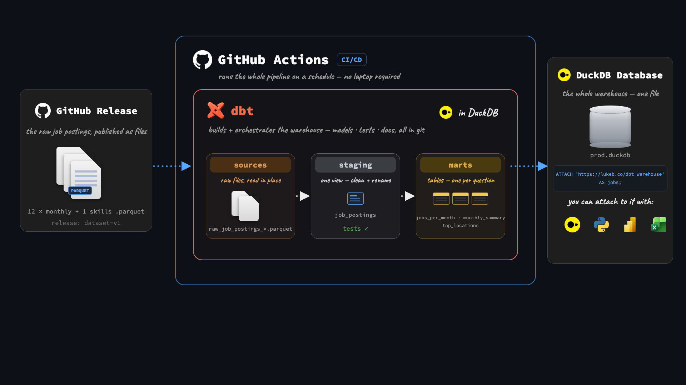

# Automated Job Postings Pipeline (V1.0) - dbt + DuckDB

A public dbt + DuckDB pipeline over ~692k real job postings, rebuilt and republished automatically on every push.
- Models the raw postings into tested, documented insight marts
- Publishes the docs site and the finished warehouse - open to anyone, no credentials
- Runs itself on Github Actions

> **v1 of this pipeline** - everything free and local-friendly: DuckDB as the warehouse, Github Actions as the scheduler. [v2](../ project 21) rebuilds it production-grade on Databricks.