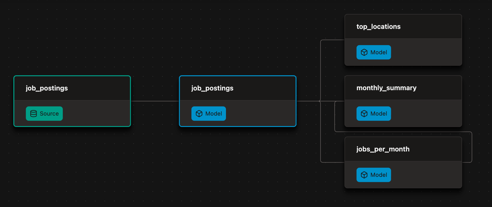

# Automated Job Postings Pipeline (v1) - dbt + DuckDB

[](https://github.com/mmarquez225/dbt-duckdb-pipline/actions/workflows/dbt_build.yml)
[](https://mmarquez225.github.io/dbt-duckdb-pipline/)


A public dbt + DuckDB pipeline over ~692k real job postings, rebuilt and republished automatically on every push.

- Models the raw postings into tested, documented insight marts
- Publishes the docs site and the finished warehouse — open to anyone, no credentials
- Runs itself on GitHub Actions: on every push and once a month when new data lands

> **v1 of this pipeline** — everything free and local-friendly: DuckDB as the warehouse, GitHub Actions as the scheduler. v2 will rebuild it production-grade on Databricks.

| What I Built | How I Implemented | Where to Look |
| --- | --- | --- |
| **dbt pipeline** | sources → cleaned model → insight marts | [`analytics/models/`](analytics/models/) |
| **Data tests** | `unique` / `not_null` on key columns | [`schema.yml`](analytics/models/schema.yml) |
| **Hosted dbt docs** | lineage, descriptions, column tests | [Live docs site](https://mmarquez225.github.io/dbt-duckdb-pipline/) |
| **Public CI** | build + test + publish on every push | [Actions workflow](https://github.com/mmarquez225/dbt-duckdb-pipline/actions/workflows/dbt_build.yml) |
| **Environments** | local `dev` target vs CI `prod` target | [`ci/profiles.yml`](ci/profiles.yml) |
| **Published warehouse** | one `ATTACH`, queryable by anyone | [Query it](#-query-the-published-warehouse) |

---

## ⚙️ The dbt Pipeline

Raw postings flow through three dbt layers — declared sources → a cleaned staging view (`job_postings`) → insight marts — with tests gating every build. The DAG below is the whole flow:



And the dbt features doing the work:

| dbt Feature | How I Used It |
| --- | --- |
| Declared sources (no hardcoded paths in SQL) | [`properties.yml`](analytics/models/properties.yml) + `source('raw', 'job_postings')` |
| Model dependencies | `ref()` everywhere downstream; dbt resolves order and parallelism |
| Materializations | project default `table`; `job_postings` overridden to `view` |
| Data tests | `unique` / `not_null` in [`schema.yml`](analytics/models/schema.yml), e.g. one row per `month` in `monthly_summary` |
| Environments | local `dev` target in your own `~/.dbt/profiles.yml`; CI `prod` target in [`ci/profiles.yml`](ci/profiles.yml) |

`dbt build` compiles SQL, materializes models, and fails the run if any test fails — same command locally and in CI.

---

## 🚀 Production

GitHub Actions runs the whole pipeline — no laptop required: [`.github/workflows/dbt_build.yml`](.github/workflows/dbt_build.yml)

| Trigger | What happens |
| --- | --- |
| Push to `master` | Full rebuild |
| Monthly (6th, 06:17 UTC) | Scheduled rebuild after the new month of postings lands |
| Manual (`workflow_dispatch`) | Run button in the Actions UI |

On each run, Actions:

1. Installs deps with `uv`
2. Downloads raw parquet
3. Runs `dbt build` with the committed CI profile (prod)
4. Publishes `prod.duckdb` as an asset on the [`warehouse` release](https://github.com/mmarquez225/dbt-duckdb-pipline/releases/tag/warehouse)

The badge at the top of this README links to the latest runs.

---

## 🦆 Query the published warehouse

No clone required. [Install DuckDB](https://duckdb.org/docs/installation/) (`brew install duckdb`), then from a `duckdb` session:

```sql
INSTALL httpfs;
LOAD httpfs;

ATTACH 'https://github.com/mmarquez225/dbt-duckdb-pipline/releases/download/warehouse/prod.duckdb' AS jobs (READ_ONLY);
USE jobs;
SHOW TABLES;

SELECT * FROM top_locations;
SELECT * FROM monthly_summary;
```

> `ATTACH` reads the database straight from the [`warehouse` release](https://github.com/mmarquez225/dbt-duckdb-pipline/releases/tag/warehouse), read-only. You can also download `prod.duckdb` from there and open it locally with `duckdb prod.duckdb`.

---

## 📖 Docs

Docs are generated with `dbt docs generate`, committed to [`docs/`](docs/), and served by GitHub Pages:

**→ [mmarquez225.github.io/dbt-duckdb-pipline](https://mmarquez225.github.io/dbt-duckdb-pipline/)**

The site shows:

- The full **lineage graph** (sources → models → marts)
- **Model and column descriptions** from the YAML
- Which columns carry **tests**

---

## 💻 Run it yourself

```bash
uv sync
uv run python scripts/download_data.py   # run from the repo root
cd analytics
uv run dbt build                          # uses your local profile (dev)
# or build against the CI profile instead:
uv run dbt build --profiles-dir ../ci
```

Optional docs locally (still inside `analytics/`):

```bash
uv run dbt docs generate
uv run dbt docs serve
```

---

## 📁 Project layout

```text
.
├── .github/workflows/dbt_build.yml   # public CI: build, test, publish
├── ci/profiles.yml                   # prod DuckDB target for Actions
├── data/                             # raw + warehouses (gitignored; CI regenerates)
├── docs/                             # dbt docs site (GitHub Pages)
├── img/                              # diagrams used in this README
├── analytics/
│   ├── dbt_project.yml
│   └── models/                       # SQL models, properties.yml (sources), schema.yml (tests + docs)
└── scripts/download_data.py          # fetch raw parquet before build
```

---

*Dataset: real job postings, refreshed monthly.*